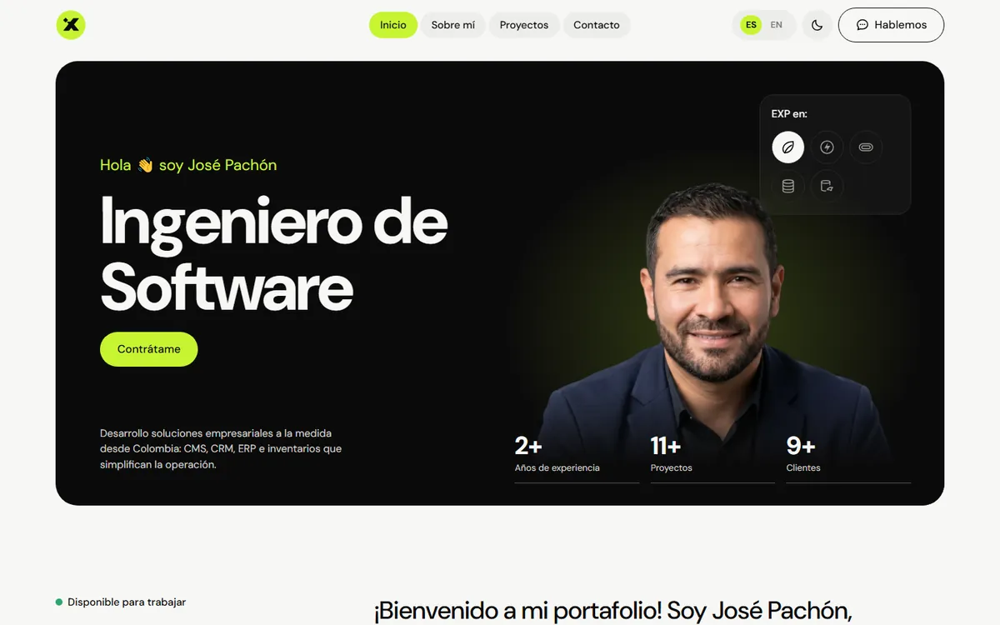
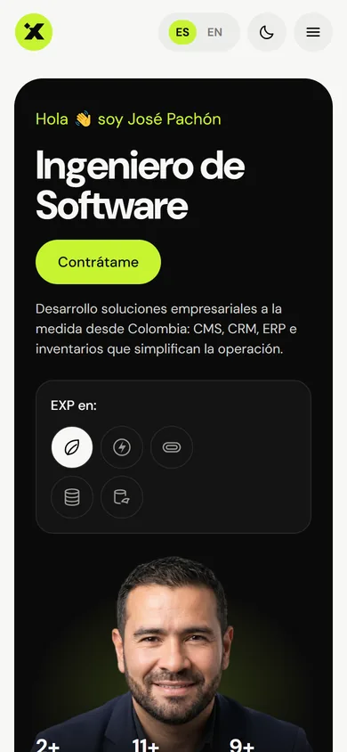

# Mi Portafolio Web Interactivo

Portafolio profesional de **José Pachón**, ingeniero de software en Colombia. Es un sitio estático, construido con HTML5, CSS3 y JavaScript puro, que presenta mi perfil, mis proyectos, las tecnologías que uso y un formulario de contacto.

**Sitio publicado:** https://josepachonlondono-cell.github.io/miportafolio/

> Proyecto académico, actividad integradora de la Unidad 1 del curso *Lenguajes de Programación para la Web*, Ingeniería de Software, Fundación Universitaria María Cano (2026).

---

## Descripción

El sitio aplica los tres pilares del desarrollo *frontend*:

| Capa | Responsabilidad | Archivos |
|---|---|---|
| **HTML5** | Estructura semántica y accesible | `index.html` |
| **CSS3** | Presentación responsiva (mobile first) | `css/` |
| **JavaScript** | Comportamiento e interactividad | `js/` |

### Funcionalidades

- **Presentación personal** con indicadores animados (años de experiencia, proyectos y clientes).
- **Proyectos cargados dinámicamente** desde un arreglo de objetos y mostrados en un acordeón.
- **Grilla de tecnologías y habilidades** generada con JavaScript.
- **Formulario de contacto** con validación en tiempo real y envío simulado.
- **Menú responsive** tipo hamburguesa en móvil y tableta.
- **Cambio de idioma** español / inglés.
- **Tema claro / oscuro** que respeta la preferencia del sistema.
- **Animaciones sutiles**: aparición al hacer scroll, texto que se revela y menú que resalta la sección visible. Se desactivan si el usuario prefiere movimiento reducido.

---

## Tecnologías utilizadas

- **HTML5**: etiquetas semánticas (`header`, `nav`, `main`, `section`, `article`, `aside`, `footer`), metaetiquetas y Open Graph.
- **CSS3**: variables (*custom properties*), Flexbox, CSS Grid, media queries (768 px y 1024 px), `clamp()` y transiciones.
- **JavaScript (ES6+)**: manipulación del DOM, eventos, `IntersectionObserver`, `localStorage` y eventos personalizados.
- **Git y GitHub Pages**: control de versiones y despliegue.
- **Google Fonts**: tipografía DM Sans.

No usa *frameworks* ni librerías externas de JavaScript.

---

## Estructura del proyecto

```
miportafolio/
├── index.html
├── README.md
├── LICENSE
├── css/
│   ├── reset.css          # normaliza estilos entre navegadores
│   ├── variables.css      # paleta, tipografía, espaciado y tema oscuro
│   ├── layout.css         # estructura y diseño responsivo
│   └── components.css     # botones, tarjetas, formulario y estados
├── js/
│   ├── data.js            # proyectos, habilidades y textos ES/EN
│   ├── main.js            # idioma, tema, menú y render del DOM
│   ├── form-handler.js    # validación y envío simulado del formulario
│   └── animations.js      # aparición, contadores, texto y acordeón
└── assets/
    ├── images/            # fotografía, proyectos y capturas
    └── icons/             # logo, favicon e íconos de tecnologías
```

---

## Instalación y ejecución local

1. Clona el repositorio:

   ```bash
   git clone https://github.com/josepachonlondono-cell/miportafolio.git
   ```

2. Entra a la carpeta del proyecto:

   ```bash
   cd miportafolio
   ```

3. Abre el sitio de una de estas formas:
   - Abre `index.html` directamente en el navegador.
   - O, recomendado, usa un servidor local, por ejemplo la extensión **Live Server** de VS Code, o:

     ```bash
     python -m http.server 5500
     ```

     Luego visita `http://localhost:5500`.

No requiere instalar dependencias.

---

## Capturas de pantalla

| Escritorio | Móvil |
|---|---|
|  |  |

---

## Autor

**José Pachón**, Ingeniero de Software

- Correo: [jose.pachon@hotmail.com](mailto:jose.pachon@hotmail.com)
- GitHub: [@josepachonlondono-cell](https://github.com/josepachonlondono-cell)
- Empresa: [ismux.com](https://www.ismux.com/)

---

## Licencia

Este proyecto se distribuye bajo la licencia **MIT**. Consulta el archivo [LICENSE](LICENSE) para más detalles.
